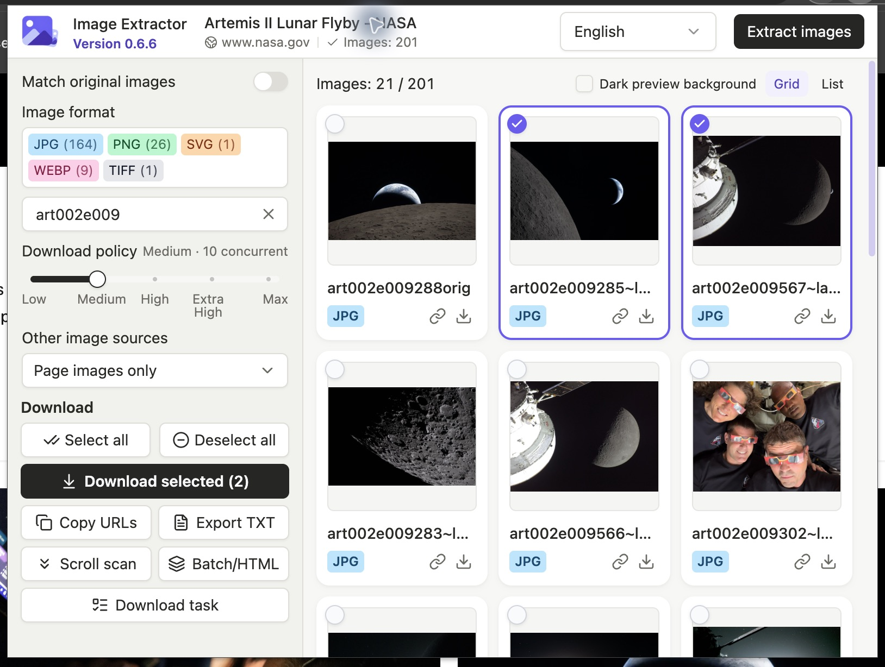

# Image Extractor

**A Chrome extension to extract webpage images, resolve original URLs from supported thumbnails, and download selected images as ZIP archives.**

[简体中文](README.zh-CN.md) · [MIT License](LICENSE)

Image Extractor works with the current webpage, batches of URLs, and saved HTML files. Preview and filter page images, optionally enable original matching, then download a ZIP, copy the selected URLs, or export a link list. Downloads support failed-only retries, cache-based recovery, and five adjustable download policies.

Current version: **0.6.6**. Install as an unpacked Chrome extension using the instructions below.

## Screenshots

Real Chrome extension captures at 1628 × 1228, showing NASA's lunar-flyby gallery filtered by `art002e009`. The English view has two manually selected images; new results start unselected, as shown in the [Chinese capture](docs/screenshots/popup-zh-CN.jpg).



Imagery credit: NASA, from the [Artemis II Lunar Flyby gallery](https://www.nasa.gov/gallery/lunar-flyby/). These interface examples do not imply NASA affiliation or endorsement. [Capture details](docs/screenshots/README.md).

## Features

- **Image discovery:** Collect `img` / `picture` sources, common lazy-loading attributes, direct image links, and image metadata. Website icons, CSS backgrounds, embedded images, and inline SVG are optional and enabled by default.
- **Thumbnail-to-original URL matching:** Built-in rules cover supported address patterns on IMX, Imgbox, Pixhost, Vipr, and other image hosts. The default view contains image URLs found on the page. Enable **Match original images** to show only supported matches; no matches produce an empty result.
- **Batch URLs and local HTML:** Process up to 20 webpages or HTML files per batch, with per-page results, progress, stop controls, and download outcomes. Local HTML supports an original webpage URL or a valid `<base>` for relative links.
- **Compact image workspace:** Proportional, uncropped previews; grid/list views; format and text filters; full-selection controls; keyboard navigation; a dark preview background; and preview failure retries. Images retain page discovery order.
- **ZIP downloads:** Page-title archive names, numbered image filenames, unchanged image bytes, and a single image set for the active mode. Partial success retains downloaded images and includes a failure report.
- **Retry and recovery:** Retry only failed images without fetching successful ones again. Interrupted tasks can reuse completed files from valid, checked local cache for up to 24 hours.
- **Five-step download slider:** Low, Medium, High, Extra High, and Max. Shared concurrency, request spacing, and server-driven cooldown apply across task pages. Medium is the default.
- **Page isolation:** Selections and download progress belong to the source tab and URL. Another page can start its own task while all tasks share the same network limits.
- **Shared download manager:** View tasks from every page in one table, with independent progress, cancellation, retry, and recovery. ZIP filenames, source URLs, and failure causes are shown in the task row. One global button opens the downloads folder.
- **Link export and languages:** Copy selected URLs or export TXT. English and Simplified Chinese follow the browser language by default; the header language selector synchronizes across extension pages.

## Install from source

Requirements: Chrome **120+** and Node.js **22.12+**, or a newer LTS version satisfying the dependency engine requirements.

```sh
npm ci
npm run build
```

1. Open `chrome://extensions` and enable **Developer mode**.
2. Select **Load unpacked** and choose `.output/chrome-mv3`.
3. Open a webpage and click the extension icon.

Load the build directory, not the source directory. Builds do not launch or reload Chrome automatically. Keep active download task pages open and wait for downloads to finish before reloading the extension.

## Use

1. Open a page containing images. Complete any website verification yourself and load the desired page content.
2. Open Image Extractor. It automatically analyzes a new page and restores matching results when available. Use **Extract images** to refresh results.
3. Choose page images (default) or enable **Match original images**, then use format and search filters. New extraction results start with nothing selected. Click individual images or use **Select all**. Switching mode does not add selections; previous manual choices are retained, and downloads, copying and TXT export use only the current mode. Reopening the same results restores your manual choices; re-extracting starts a new, unselected result set. Search and format filters preserve hidden selections within that mode. **Select all** selects visible results; **Deselect all** clears every selection, including hidden ones.
4. Choose a download policy, then select **Download selected**. Chrome requests download and image-host access permissions when needed.
5. Open **Download task** in the sidebar to view all page downloads in one place. You may close the popup; keep the download manager open until its tasks finish.
6. Use the sidebar **Copy URLs** and **Export TXT** buttons. Single-image actions copy a URL or save that image in a ZIP.
7. Open **Batch / HTML** in the sidebar for batch processing. Open each webpage and choose images through the extension, or open an imported HTML result workspace and choose images there, before starting downloads. Optional bounded scrolling loads more page content and then restores the scroll position.

**Other image sources** controls icons, CSS backgrounds, and embedded images/SVG and takes effect on the next extraction. Disabling all additional sources still extracts ordinary page images. The download slider previews a policy while dragging and saves it on release; arrow keys, Home, and End also work. Settings synchronize across task pages.

## Download manager

All webpages share one task overview. Each task has its own selection snapshot, progress, cancellation, failed-only retry, and cache recovery. Closing this page interrupts the tasks it is running; completed cached files can be reused when recovery is available.

- **Read the results in the row:** ZIP filename, source webpage URL (or the local HTML label when no original page URL was provided), successful/failed image counts, file size, and failure causes are shown directly. Long failure lists scroll within the row; no separate details dialog is needed.
- **Distinguish processing from saving:** Purple means successful images, amber means failed images, and gray means pending images. A fully processed bar can include failures. Packing and saving remain indeterminate until Chrome confirms the ZIP save.
- **Recover only what is missing:** Retry failed images without fetching successful ones again, or resume an interrupted task from valid local cache. Each action affects only its own task.
- **Open the downloads folder:** The single button above the table opens Chrome's default downloads folder. It applies to all tasks.

Saved ZIPs with partial failures have a warning status; unsaved failures are red, and cancellation is neutral. Status labels and numeric counts accompany the colors. On narrow screens the same task rows wrap without restarting downloads.

## Original URL matching

Matching uses site-specific URL rules; it does not upscale images or perform reverse image search. For example:

```text
https://image.imx.to/u/t/<path>/<name>.jpg
https://t01.imx.to/t/<path>/<name>.jpg
                         ↓
https://i02.imx.to/i/<path>/<name>.jpg
```

“Original” means an address matched a supported rule, not that its dimensions or availability have been verified. Extraction does not fetch converted originals. Unmatched source URLs remain available with original matching turned off; they are not classified by resolution. URL deduplication is not image-content deduplication.

Website changes, permissions, redirects, and verification pages may prevent conversion or downloading. Support for an image host means supported URL patterns, not every image on that host.

## Download policies

All tasks share a **hard limit of 30 in-flight image transfers**. Each source has its own policy limit and start interval; the same source across several tabs shares those limits.

| Policy | Per-source concurrency | Minimum start interval per source | Minimum global start interval |
| --- | ---: | ---: | ---: |
| Low | 5 | 2 s | 250 ms |
| Medium (default) | 10 | 500 ms | 150 ms |
| High | 20 | 100 ms | 100 ms |
| Extra High | 25 | 75 ms | 75 ms |
| Max | 30 | 50 ms | 50 ms |

Known shards of IMX, Vipr, Pixhost, Imagebam, and Imgbox share a provider budget. Other hosts are separated by URL origin. A single task can use available capacity within these limits; capacity is not multiplied by opening more tabs, and equal sharing is not guaranteed.

HTTP 429 / 503 responses trigger shared cooldown, honor `Retry-After`, and reduce per-source concurrency during recovery. These controls limit request pressure, not bytes per second, and cannot guarantee that a website will not throttle requests. Higher presets have not all been validated against real image hosts. See [download policy details and test scope](docs/download-policy.md).

## Output and recovery

- Archives use the webpage title, with invalid filename characters replaced. Image names use a sequence prefix such as `001_photo.jpeg`.
- New tasks save the active mode as a single image set. Retries of older tasks retain their original folder paths. Filename extensions are determined from actual image signatures; image bytes are preserved.
- Partial downloads include a failure report. An all-failed task does not save an empty ZIP.
- Failed-only retries produce a separate supplementary ZIP and preserve numbering and paths, allowing its contents to be merged with the original archive.
- Recovery verifies completed cached files before reusing them. It is file-based recovery, not HTTP Range byte-level resume. Cache availability depends on browser storage and a 24-hour retention window.
- Limits: **2,000 images per ZIP**, **128 MB per image**, **4 GB total image data**. HTML import accepts up to **20 files**, **16 MB each**. Storage quota failures are reported explicitly.

Downloads and ZIP creation stream through browser-local temporary storage instead of buffering the entire collection in memory. Waiting for response headers and response-body stalls have separate timeouts; a slow transfer making progress has no fixed total-duration timeout.

## Permissions and privacy

The default permissions are `activeTab`, `scripting`, and `storage`. Download and website-access permissions are requested when needed. Optional HTTP/HTTPS host patterns allow those requests; they are not an automatic grant of access to every website.

Page extraction and URL conversion run locally without an external extraction service. Previews load source images, and downloads contact the selected image hosts; normal browser and website cookie policies apply. Local HTML import does not execute its scripts or load its iframes. The extension does not bypass website verification.

## Scope and limitations

- Main-frame discovery cannot guarantee access to cross-origin iframes, closed shadow roots, or images that have not loaded.
- Local HTML cannot reproduce script-generated content or external stylesheet behavior.
- No server crawler, AI upscaling, content-hash deduplication, image sorting, or guaranteed original-resolution detection.
- The extension builds and tests independently; it does not require a sibling crawler project or server.

See the [crawler feature comparison](FEATURE_PARITY.md) for the detailed migration boundaries.

## Development

React, TypeScript, WXT, Tailwind CSS, and locally bundled shadcn/ui components.

```sh
npm ci
npm run typecheck
npm test -- --maxWorkers=1
npm run build
npm run check:bundle
```

The full test suite includes a local HTTP streaming test and needs permission to listen on loopback. For offline tests without a local listener:

```sh
npm test -- --exclude tests/archive-network.test.ts --maxWorkers=1
```

To build a candidate without replacing the usual build directory:

```sh
node --input-type=module -e 'import { build } from "wxt"; await build({outDir:".output-staged"});'
EXTENSION_BUILD_DIR=.output-staged/chrome-mv3 npm run check:bundle
```

Use `npm run icons` to regenerate icons. Original URL rules live in `lib/originalImageResolver.js` and `lib/legacyOriginalRules.js`; update their version and regression fixtures when rules change. Commits, PR titles, and release notes use English; commits follow Conventional Commits.

[Manual Chrome acceptance](docs/release-smoke.md) · [Release notes](docs/release-notes.md) · [Download policy](docs/download-policy.md)

## License

[MIT](LICENSE), Copyright (c) 2026 Image Extractor contributors. Dependencies retain their own licenses. Built packages include `THIRD_PARTY_LICENSES.md` and `THIRD_PARTY_NOTICES.md`; copied shadcn/ui source also includes its MIT license in `components/ui/LICENSE.md`.
