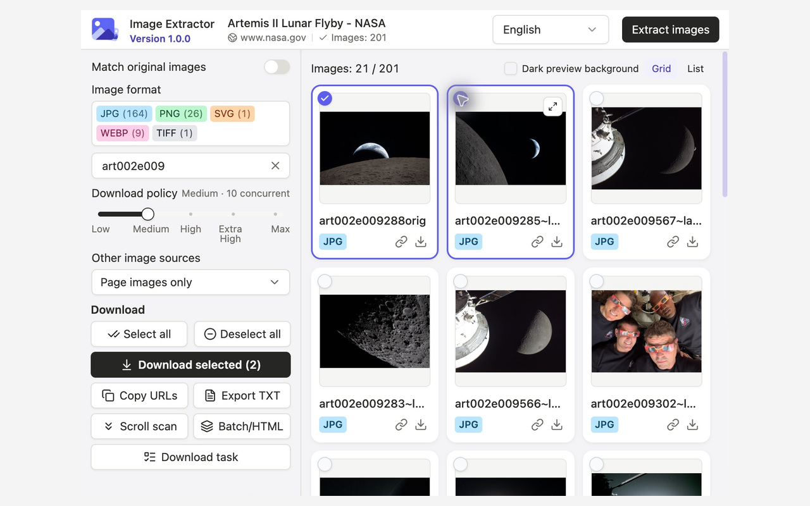

# Image Extractor

**English** | [简体中文](README.zh-CN.md)

**Extract images from webpages, match supported thumbnail URLs to originals, and download your selection as a ZIP.**

Preview and filter images from the current page, batches of URLs, or saved HTML files. All features are free, with no account required. The interface supports English and Simplified Chinese.

Stable release: **[1.0.0](https://github.com/zenvor/image-extractor-extension/releases/tag/v1.0.0)**. Download the ready-to-load Chrome ZIP below; building from source is optional. The Chrome Web Store submission was last verified as **pending review** on October 25, 2026.



Real Chrome capture. Imagery: NASA's [Artemis II Lunar Flyby gallery](https://www.nasa.gov/gallery/lunar-flyby/). No NASA affiliation or endorsement is implied. [Screenshot preparation](docs/store-assets/README.md).

## Features

- **Find and filter images.** Collect ordinary and lazy-loaded images, with optional icons, CSS backgrounds and embedded images. Preview results in a grid or list and filter by format or text.
- **Match supported originals.** Convert supported thumbnail URL patterns on IMX, Imgbox, Pixhost, Vipr, Duitang and other image hosts. Ordinary page-image extraction also works without an original-matching rule.
- **Process multiple sources.** Extract from the current webpage, up to 20 webpage URLs, or up to 20 local HTML files per batch.
- **Download and recover.** Save selected images as numbered files in a ZIP. View tasks in one download manager, retry failed images separately, or recover interrupted tasks when valid cached files are available. Five download policies control request pressure.
- **Export links.** Copy selected image URLs or save them as a TXT list.

## Install

Requires **Chrome 120+**.

### Download the release ZIP (recommended)

1. Download [image-extractor-1.0.0-chrome.zip](https://github.com/zenvor/image-extractor-extension/releases/download/v1.0.0/image-extractor-1.0.0-chrome.zip) from the [1.0.0 release](https://github.com/zenvor/image-extractor-extension/releases/tag/v1.0.0). Choose this extension ZIP rather than GitHub's **Source code** archives.
2. Extract it to a folder you will keep on your computer.
3. Open `chrome://extensions` and enable **Developer mode**.
4. Select **Load unpacked** and choose the extracted folder containing `manifest.json`.
5. Open a webpage and click the Image Extractor icon.

No Node.js, npm or build step is needed. Keep the extracted folder in place while the extension is installed. A [SHA-256 checksum](https://github.com/zenvor/image-extractor-extension/releases/download/v1.0.0/image-extractor-1.0.0-chrome.zip.sha256) is available alongside the ZIP.

### Build from source (optional)

You need **Chrome 120+**, **Git**, and **Node.js 22.12+** (or a newer supported LTS release).

```sh
git clone https://github.com/zenvor/image-extractor-extension.git
cd image-extractor-extension
npm ci
npm run build
```

1. Open `chrome://extensions` and enable **Developer mode**.
2. Select **Load unpacked** and choose the project's `.output/chrome-mv3` directory.
3. Open a webpage and click the Image Extractor icon.

`npm ci` installs the dependency versions recorded in `package-lock.json` without changing it. Use `npm install` when adding or updating dependencies; see the [development guide](docs/development.md#dependency-installation).

Load the built directory rather than the source directory. Finish active downloads before rebuilding or reloading an installed extension.

## Quick start

1. Open a page containing images and load the content you want to save.
2. Click the extension icon. New pages are analyzed automatically; use **Extract images** to refresh the results.
3. Filter the results and select images individually or with **Select all**. New extraction results start unselected. Enable **Match original images** if you want supported URL matches.
4. Select **Download selected** and grant download or site permissions when prompted. The default download policy is **Medium**.
5. Follow progress in **Download task**. You can close the popup, but keep the download manager open until the tasks finish.

**Filtering preserves hidden selections.** Select all chooses visible results; Deselect all clears every selection in the current mode. Downloads, copying and TXT export use the current mode's selected images.

For batch URLs, HTML import, selection behavior and retry instructions, see the [usage guide](docs/usage.md).

## Limits and privacy

- Original matching uses site-specific URL rules. It does not verify resolution or guarantee a downloadable original. Website changes, authentication and throttling can affect extraction and downloads; the extension does not bypass verification.
- Cross-origin frames, closed shadow roots and content that has not loaded may be inaccessible. Imported HTML cannot reproduce script-generated content.
- Closing the download manager interrupts active tasks. Recovery reuses complete cached files where available; browser storage limits and the 24-hour cache retention window mean recovery is not guaranteed.
- Each ZIP supports up to **2,000 images**, **128 MB per image** and **4 GB of image data**. HTML imports support up to **20 files**, **16 MB each**.

Extraction and URL matching run locally, with no external extraction service or analytics. Previews and downloads contact the source websites and follow browser cookie policies. Preferences, task history and temporary download files are stored locally.

The extension requires `activeTab`, `scripting` and `storage`; download and website-access permissions are requested when needed. See the [privacy policy](docs/privacy-policy.md) for data handling and retention.

## Documentation and feedback

- [Usage guide](docs/usage.md): selection, batches, ZIP output, retries and recovery.
- [Download policies](docs/download-policy.md): request limits and throttling behavior.
- [Release notes](docs/release-notes.md).
- [Report a problem](https://github.com/zenvor/image-extractor-extension/issues): include the extension version, steps to reproduce, expected and actual behavior, and a public page URL when possible. Remove private URLs, cookies and other sensitive data before sharing logs or screenshots.

## Development

Built with React, TypeScript, WXT, Tailwind CSS and shadcn/ui.

```sh
npm ci
npm run typecheck
npm test -- --maxWorkers=1
npm run build
npm run check:bundle
```

See the [development guide](docs/development.md) for test requirements, isolated builds and source layout, and [release instructions](docs/releasing.md) for manually authored GitHub Releases and automatic build attachments.

## License

[MIT](LICENSE), Copyright (c) 2026 Image Extractor contributors. Dependencies retain their own licenses. Built packages include `THIRD_PARTY_LICENSES.md` and `THIRD_PARTY_NOTICES.md`; copied shadcn/ui source also includes its MIT license in `components/ui/LICENSE.md`.
