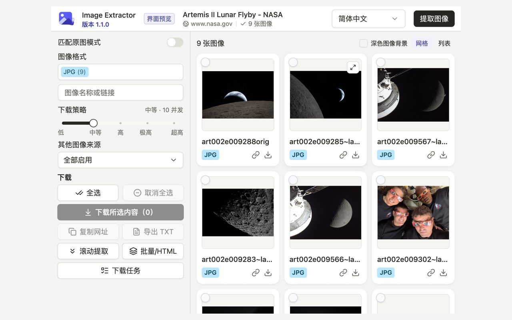

# Image Extractor

**从网页提取图像，按已适配规则匹配原图地址，将所选图片打包为 ZIP。**

支持当前网页、批量网址和本地 HTML 文件，提供图像预览、筛选和链接导出。全部功能免费，无需账号，界面支持简体中文与英文。

当前源码版本：**1.0.0**。已于 2026 年 10 月 25 日提交 Chrome 商店，最后核验状态为**审核中**。目前可按下文步骤从源码安装。



Chrome 实机截图。图像来源：NASA 的 [Artemis II Lunar Flyby 图集](https://www.nasa.gov/gallery/lunar-flyby/)，不表示 NASA 与本项目有关联或为本项目背书。[截图处理说明](docs/store-assets/README.md)。

## 主要功能

- **提取与筛选图像：** 收集普通图像和懒加载图像，可选采集图标、CSS 背景及内嵌图像；支持网格或列表预览，以及格式和文字筛选。
- **匹配已适配的原图地址：** 支持 IMX、Imgbox、Pixhost、Vipr、堆糖等图床的部分缩略图地址规则；没有匹配规则的网页也可使用普通图像提取。
- **处理多种来源：** 支持当前网页、每批最多 20 个网页网址或 20 个本地 HTML 文件。
- **下载与恢复：** 将所选图片按顺序编号并保存为 ZIP，在统一任务页查看进度；可单独重试失败图片，或在有效缓存可用时恢复中断任务。五档下载策略用于调节请求压力。
- **导出链接：** 复制所选图像网址，或保存为 TXT 链接清单。

## 从源码安装

需要 **Chrome 120+**、**Git** 和 **Node.js 22.12+**，也可使用满足要求的更新 LTS 版本。

```sh
git clone https://github.com/zenvor/image-extractor-extension.git
cd image-extractor-extension
npm ci
npm run build
```

1. 打开 `chrome://extensions`，开启「开发者模式」。
2. 点击「加载已解压的扩展程序」，选择项目下的 `.output/chrome-mv3` 目录。
3. 打开一个网页，点击 Image Extractor 图标。

加载的是构建产物目录，而不是源码目录。重新构建或重载已安装的扩展前，请先等待正在进行的下载完成。

## 快速开始

1. 打开包含图片的网页，加载需要保存的内容。
2. 点击扩展图标，新页面会自动分析；点击「提取图像」可刷新结果。
3. 筛选结果，逐张勾选或点击「全选」。新提取结果默认不勾选；需要使用已适配的地址规则时，开启「匹配原图模式」。
4. 点击「下载所选内容」，按提示授予下载或网站访问权限。下载策略默认为「中等」。
5. 在「下载任务」中查看进度。可以关闭弹窗，下载完成前请保持下载任务页打开。

**筛选会保留隐藏图片的勾选。**「全选」选择可见结果，「取消全选」清空当前模式的全部勾选。下载、复制和 TXT 导出使用当前模式中已勾选的图片。

批量网址、HTML 导入、选图规则和失败重试的详细操作见[使用说明](docs/usage.zh-CN.md)。

## 限制与隐私

- 原图匹配依靠站点 URL 规则，不会验证实际分辨率，也不保证匹配地址可下载。站点改版、登录要求和限流可能影响结果；扩展不会绕过网站验证。
- 跨域 iframe、封闭 Shadow DOM 和尚未加载的内容可能无法采集。本地 HTML 无法还原脚本生成的内容。
- 关闭下载任务页会中断正在执行的任务。恢复依赖已完整缓存的文件，受浏览器存储空间和 24 小时缓存保留窗口限制，不保证一定能够恢复。
- 每个 ZIP 最多包含 **2000 张图像**，单图 **128 MB**，图像总量 **4 GB**；HTML 导入每批最多 **20 个文件**，单文件 **16 MB**。

提取和地址匹配在本地执行，不依赖外部提取服务，也没有集成统计分析。预览和下载会访问源网站，并遵循浏览器的 Cookie 策略。偏好设置、任务历史和临时下载文件保存在本地。

默认权限为 `activeTab`、`scripting` 和 `storage`；下载与网站访问权限按需申请。数据处理和保留规则见[隐私政策](docs/privacy-policy.md)。

## 文档与反馈

- [使用说明](docs/usage.zh-CN.md)：选图、批量处理、ZIP 输出、重试和恢复。
- [下载策略](docs/download-policy.md)：请求限制和网站限流处理。
- [版本说明](docs/release-notes.md)。
- [反馈问题](https://github.com/zenvor/image-extractor-extension/issues)：请提供扩展版本、复现步骤、预期与实际结果，以及方便公开的网页网址。分享日志或截图前，请移除私人链接、Cookie 等敏感信息。

## 开发

使用 React、TypeScript、WXT、Tailwind CSS 和 shadcn/ui。

```sh
npm ci
npm run typecheck
npm test -- --maxWorkers=1
npm run build
npm run check:bundle
```

测试要求、隔离构建和源码位置见[开发说明](docs/development.md)；手动编写 GitHub Release、自动上传构建附件的步骤见[发布说明](docs/releasing.md)。

## 许可证

采用 [MIT](LICENSE)，Copyright (c) 2026 Image Extractor contributors。第三方依赖保留各自许可；产物包含 THIRD_PARTY_LICENSES.md 与 THIRD_PARTY_NOTICES.md，复制的 shadcn/ui 源码另含 components/ui/LICENSE.md。
