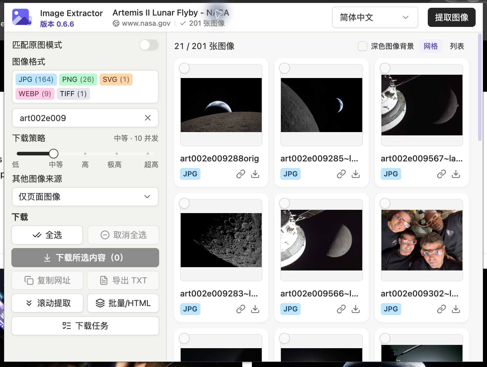

# Image Extractor

**网页图像提取、缩略图匹配原图与 ZIP 批量下载的 Chrome 扩展。**

[English](README.md) · [MIT 许可证](LICENSE)

从当前网页、批量网址或本地 HTML 中收集图像，根据已适配站点的 URL 规则匹配原图地址。默认展示页面图像，可开启原图匹配；支持预览筛选、ZIP 下载、复制网址和导出链接，以及仅重试失败项、缓存恢复和五档下载策略。

当前版本：**0.6.7**。按下文步骤构建并以已解压扩展的方式安装。

## 实机截图

以下为 Chrome 中实际运行的扩展截图，原始分辨率为 1628 × 1228；使用 NASA 月球飞掠图集，通过 `art002e009` 筛选展示。中文图展示默认未勾选状态，[英文图](docs/screenshots/popup-en.jpg)展示手动选择两张图像后的状态。



图像来源：NASA 的 [Artemis II Lunar Flyby 图集](https://www.nasa.gov/gallery/lunar-flyby/)。界面示例不表示 NASA 与本项目有关联或为本项目背书。[截图说明](docs/screenshots/README.md)。

## 主要功能

- **图像采集：** 读取 img/picture、常见懒加载属性、图像直链与语义元数据。图标、CSS 背景、内嵌图像和 SVG 可选，默认开启。
- **缩略图匹配原图：** 内置 IMX、Imgbox、Pixhost、Vipr、堆糖等图床的已适配规则。默认只展示页面中发现的图像地址；开启「匹配原图模式」后仅显示适配规则命中的原图，没有匹配结果时显示空状态。
- **批量网址和本地 HTML：** 每批最多 20 个网页或文件，提供逐页结果、进度、停止后续操作及下载结果汇总。相对链接支持原网址或有效 base。
- **图像工作区：** 图像保持比例完整展示，支持网格/列表、格式与文本筛选、全选/取消全选、键盘选图、深色预览背景和预览失败重试；保持网页发现顺序。
- **ZIP 下载：** 网页标题命名、顺序编号、保留图像原始字节；按当前模式保存为一组图像。部分失败仍保存成功图像及失败清单。
- **失败重试与恢复：** 只重新请求失败图像；中断任务可复用 24 小时有效缓存内已完成且经校验的文件。
- **五档滑块：** 低、中等、高、极高、超高，默认中等。所有任务共享并发、请求间隔及服务器冷却状态。
- **网页任务隔离：** 勾选和进度绑定来源标签及网址；其他网页可独立启动下载，但共同遵守网络限制。
- **统一下载任务页：** 在同一个表格中查看所有网页的任务，各任务可独立取消、重试和恢复。文件名、来源和失败原因直接显示在对应行，顶部提供一个全局下载文件夹入口。
- **链接导出和国际化：** 复制选定网址或导出 TXT；简体中文和英文默认跟随浏览器，头部可手动切换并同步到其他扩展页面。

## 安装

需要 Chrome **120+** 与 Node.js **22.12+**，或满足依赖引擎要求的更新 LTS 版本。

```sh
npm ci
npm run build
```

打开 `chrome://extensions`，开启开发者模式，选择「加载已解压的扩展程序」，加载 `.output/chrome-mv3`。加载的是构建产物目录，不是源码目录。构建不会自动启动或重载 Chrome；下载期间请保留任务页，不要重新加载扩展。

## 使用

1. 打开图像网页，自行完成网站验证并加载所需内容。
2. 点击扩展图标，新页面自动分析；已有匹配结果时恢复。点击「提取图像」刷新。
3. 默认查看页面图像，或开启「匹配原图模式」查看匹配结果。新提取结果默认不勾选任何图像，由你逐张选择或点击「全选」。切换模式不会新增勾选，并保留之前的手动选择；下载、复制和 TXT 导出只使用当前模式中的勾选。重新打开同一结果会恢复手动选择，重新提取则从未选状态开始。格式和搜索筛选保留当前模式内的隐藏勾选；「全选」选择可见结果，「取消全选」清空全部勾选。
4. 调整下载策略，点击「下载所选内容」，按需授予下载和图像网站权限。
5. 点击左侧「下载任务」，在同一个页面查看所有网页的下载进度。可关闭插件弹窗；下载完成前请保留任务页。
6. 左侧「复制网址」「导出 TXT」分别复制或导出选定链接；卡片按钮可复制单图链接或下载单图 ZIP。
7. 通过左侧「批量 / HTML」使用批量工具，打开各网页并通过插件选图，或打开 HTML 结果页选图，再返回批量页启动下载。主动滚动最多十步，完成后恢复位置。

「其他图像来源」控制图标、CSS 背景、内嵌图像与 SVG，在下次提取生效；全部关闭仍可提取普通网页图像。下载滑块拖动时预览档位，松开后保存，也支持方向键、Home 和 End。设置在扩展页面之间同步。

## 下载任务页

所有网页共用一个任务总览，每个任务仍保留独立的选图快照、进度、取消、仅失败项重试和缓存恢复。关闭任务页会中断由它执行的下载；存在有效缓存时，可复用已完成文件继续。

- **行内查看结果：** ZIP 文件名、来源网址（未提供原网址的 HTML 显示本地 HTML 标签）、成功与失败数量、文件大小和失败原因直接显示在对应行。长失败清单在行内滚动查看，不需要再打开明细弹窗。
- **区分处理与保存：** 紫色表示成功图像，琥珀黄色表示失败图像，灰色表示待处理。处理进度满格可能包含失败；打包与保存阶段仍显示等待动画，直到 Chrome 确认 ZIP 已保存。
- **只补齐缺失内容：** 仅重试失败图像，不重复请求成功图像；中断任务可从有效缓存恢复。每个操作只作用于对应任务。
- **统一打开目录：** 表格上方的「打开下载文件夹」打开 Chrome 默认下载目录，供所有任务共用。

已保存 ZIP 的部分失败使用警告状态，未保存的失败任务使用红色，用户取消使用中性色；状态同时提供文字和数量。窄屏下表格行会换行显示，不因此重启任务。

## 原图匹配说明

匹配依靠站点 URL 规则，不是 AI 放大或反向搜图。例如：

```text
https://image.imx.to/u/t/<path>/<name>.jpg
https://t01.imx.to/t/<path>/<name>.jpg
                         ↓
https://i02.imx.to/i/<path>/<name>.jpg
```

「原图」表示地址命中规则，不表示已经检测实际分辨率或验证可下载。提取时不请求转换后的原图。关闭匹配原图模式后可查看未命中规则的页面地址，不按分辨率划分类别；URL 去重不等于图像内容去重。站点规则、权限、重定向或验证机制变化都可能影响下载，适配部分地址不代表整个站点都支持。

堆糖作品图像保留 `dtstatic.com` CDN 域名，移除 `x-image-process` 预览处理参数或旧版 `.thumb.W_H` 缩图后缀，并保留其他查询参数。该规则不处理头像。

## 下载策略

所有标签页合计最多 **30 个在途图像传输**。同来源并发和启动间隔也在标签页之间共享：

| 档位 | 英文 | 同来源最大并发 | 同来源启动间隔 | 全局启动间隔 |
| --- | --- | ---: | ---: | ---: |
| 低 | Low | 5 | 2 秒 | 250 毫秒 |
| 中等（默认） | Medium | 10 | 500 毫秒 | 150 毫秒 |
| 高 | High | 20 | 100 毫秒 | 100 毫秒 |
| 极高 | Extra High | 25 | 75 毫秒 | 75 毫秒 |
| 超高 | Max | 30 | 50 毫秒 | 50 毫秒 |

IMX、Vipr、Pixhost、Imagebam 和 Imgbox 的已知分片共用各自提供方额度，其他网站按 URL origin 区分。单个任务可在限制内使用空闲额度；增加标签页不会放大全局上限，也不保证平均分配。

HTTP 429/503 会触发来源共享冷却，遵守 Retry-After，恢复期间暂时降低来源并发。这限制的是请求压力，不是每秒下载字节数，不能保证网站不会限流；新高档位尚未全部经过真实图床验收。[参数和测试边界](docs/download-policy.md)另有说明。

## 输出、重试和恢复

- ZIP 使用网页标题，替换文件名非法字符；图像名采用 `001_photo.jpeg` 等顺序前缀。
- 新任务按当前模式保存为一组图像；旧任务重试沿用创建时的目录路径，切换语言不改名。扩展名取自实际图像头，原始字节不重编码。
- 部分失败附失败清单；全部失败不保存空 ZIP。
- 仅失败项重试另存补充 ZIP，保留编号和路径，可解压到原目录合并。
- 缓存恢复先校验已完成文件；这是按文件恢复，不是 HTTP Range 字节续传。缓存受浏览器存储和 24 小时保留窗口限制。
- 每 ZIP 最多 **2000 张图像**，单图 **128 MB**，图像总量 **4 GB**；HTML 导入每批最多 **20 个文件**，单文件 **16 MB**。磁盘额度不足会明确提示。

图像和 ZIP 流式写入浏览器本地临时存储，不把整套图像一次读入内存。响应头等待和响应体无进展分别计时，持续有数据的慢速传输没有固定总时长限制。

## 权限与边界

默认权限为 activeTab、scripting、storage；下载及图像网站访问权限按需申请。可选 HTTP/HTTPS 范围只是允许申请，不等于默认拥有所有网站权限。

提取和地址转换本地执行，不依赖外部提取服务。预览加载源图像，下载访问选定图床，Cookie 遵循浏览器和站点策略。HTML 导入不执行脚本或加载 iframe，不绕过网站验证。

主框架采集不保证访问跨域 iframe、封闭 Shadow DOM 或尚未加载的图像；本地 HTML 无法还原脚本和外部样式生成的内容。没有服务端爬虫、AI 放大、图像内容哈希去重、图像排序或可靠原图尺寸检测。扩展可独立构建和测试，不依赖同级爬虫项目。[功能对照](FEATURE_PARITY.md)列出了详细移植范围。

## 开发与检查

```sh
npm ci
npm run typecheck
npm test -- --maxWorkers=1
npm run build
npm run check:bundle
```

完整测试包含本机 HTTP 流式下载测试，需要允许监听回环端口。不允许监听时可运行离线部分：

```sh
npm test -- --exclude tests/archive-network.test.ts --maxWorkers=1
```

下载期间可构建到候选目录，避免覆盖常用产物：

```sh
node --input-type=module -e 'import { build } from "wxt"; await build({outDir:".output-staged"});'
EXTENSION_BUILD_DIR=.output-staged/chrome-mv3 npm run check:bundle
```

`npm run icons` 重新生成图标。原图规则位于 lib/originalImageResolver.js 和 lib/legacyOriginalRules.js，修改时同步更新规则版本和回归样例。提交、PR 标题和发布说明使用英文，提交遵循 Conventional Commits。

[Chrome 手动验收](docs/release-smoke.md) · [发布说明](docs/release-notes.md) · [下载策略](docs/download-policy.md)

## 许可证

采用 [MIT](LICENSE)，Copyright (c) 2026 Image Extractor contributors。第三方依赖保留各自许可；产物包含 THIRD_PARTY_LICENSES.md 与 THIRD_PARTY_NOTICES.md，复制的 shadcn/ui 源码另含 components/ui/LICENSE.md。
