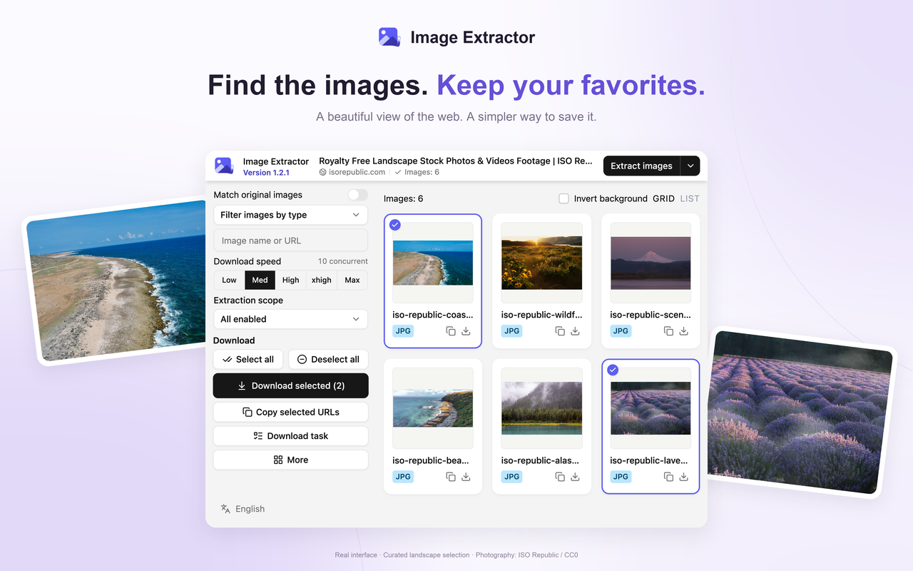
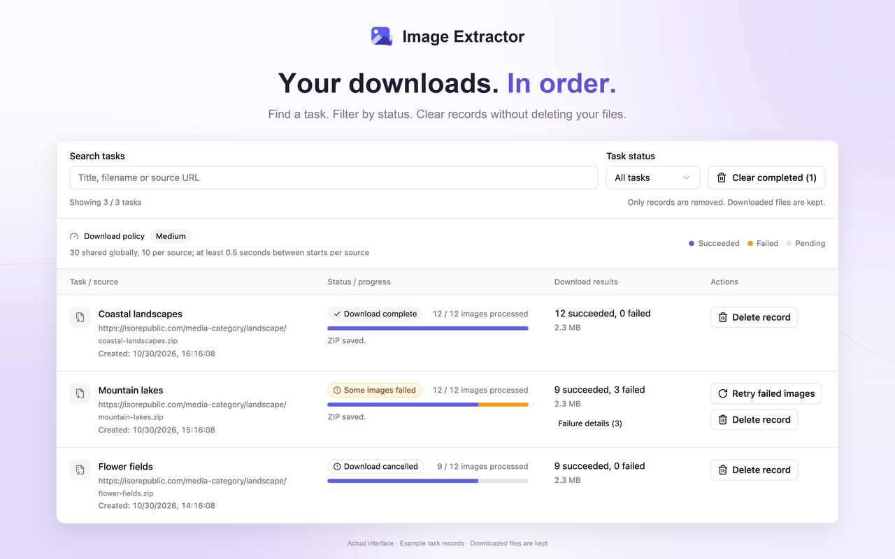
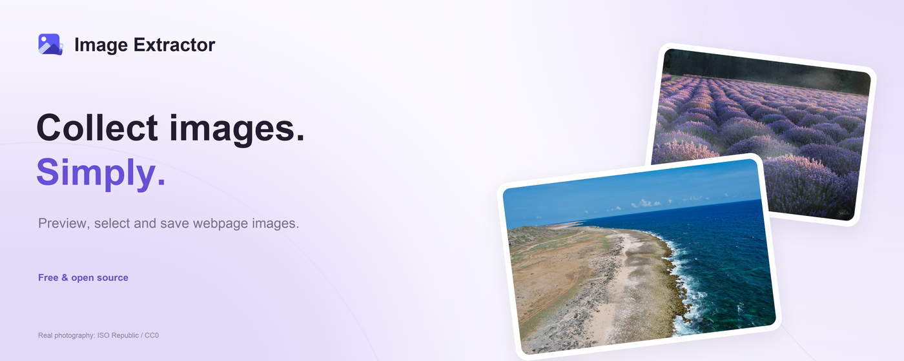
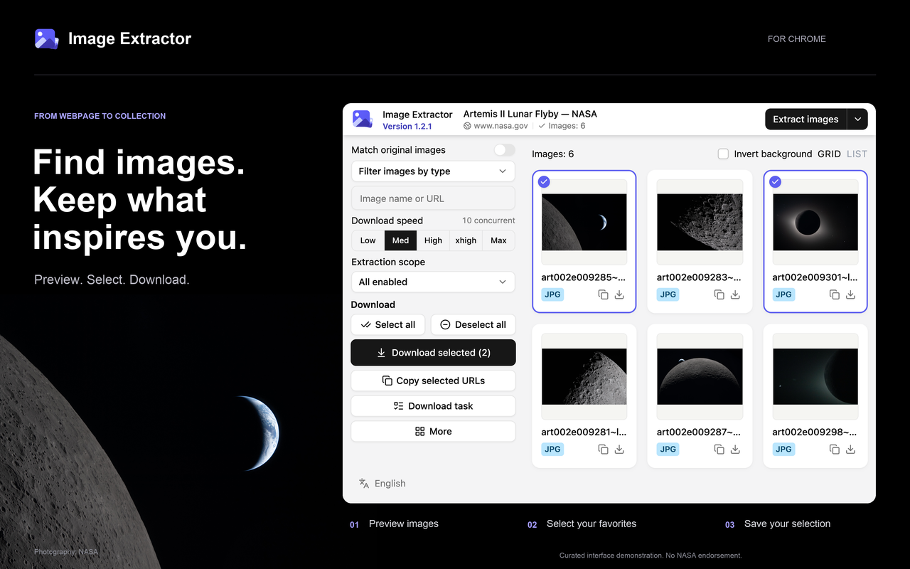
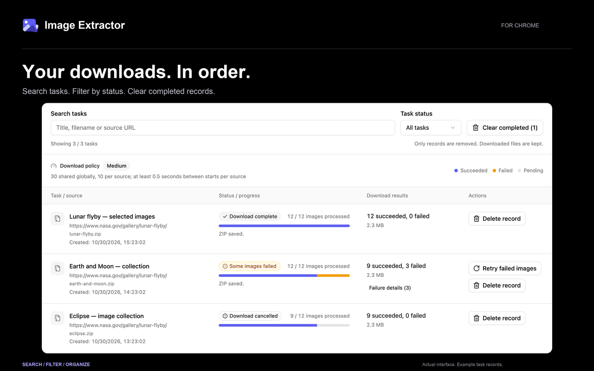
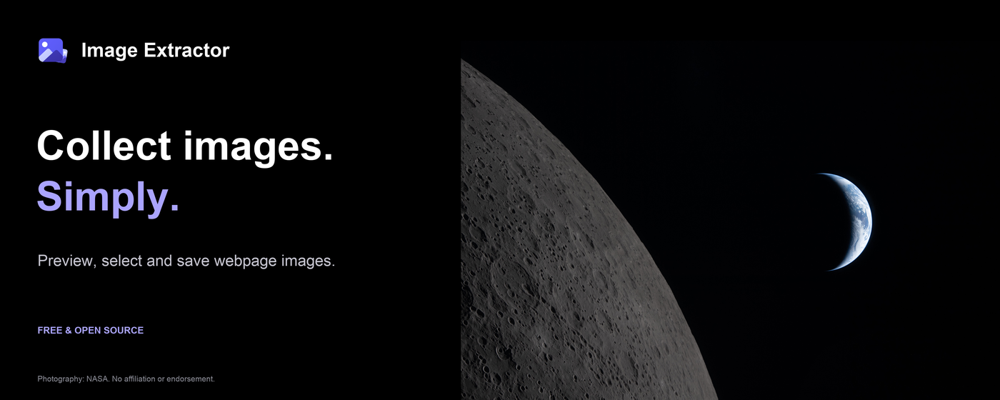

# Chrome Web Store assets

Final promotional selection for 1.2.1: **two suites, three posters per suite**. The light landscape suite is the primary presentation; the NASA dark suite remains available as an alternative. AI-generated promotional graphics and rejected design drafts have been removed from the working tree. Existing Store submissions are unchanged.

## Promotional artwork

### Primary: light landscapes

White and lavender backgrounds, real ISO Republic photography, actual interface captures and restrained layered composition. [Placement exports, 4K masters and source details](light/README.md).

### Alternative: NASA dark

Real NASA photography and actual interface captures, with purple accents. [Placement exports, 4K masters and source details](real/README.md).

Both suites provide 1280×800 browsing and download posters, 1400×560 banners, and high-resolution masters. Download task records are explicitly seeded demonstrations; action-button labels stay on one line. No product UI code changed during the artwork work.

## Additional listing assets

The bilingual **1280×800** `screenshot-en.jpg` and `screenshot-zh.jpg` remain browser captures of the current popup with a curated WhatsApp example. These are separate localized UI screenshots, not a third promotional suite. The [screenshot gallery](../screenshots/README.md) records their capture setup and credits.

The existing logo-only 440×280 tile remains available as `promo-440x280.png`, with editable source `promo-440x280.svg`. It is not AI-generated; `npm run icons` regenerates it.

Photography and screenshot provenance are documented with each suite. No third-party endorsement is implied. Publishing to the Chrome Web Store remains a separate action.
