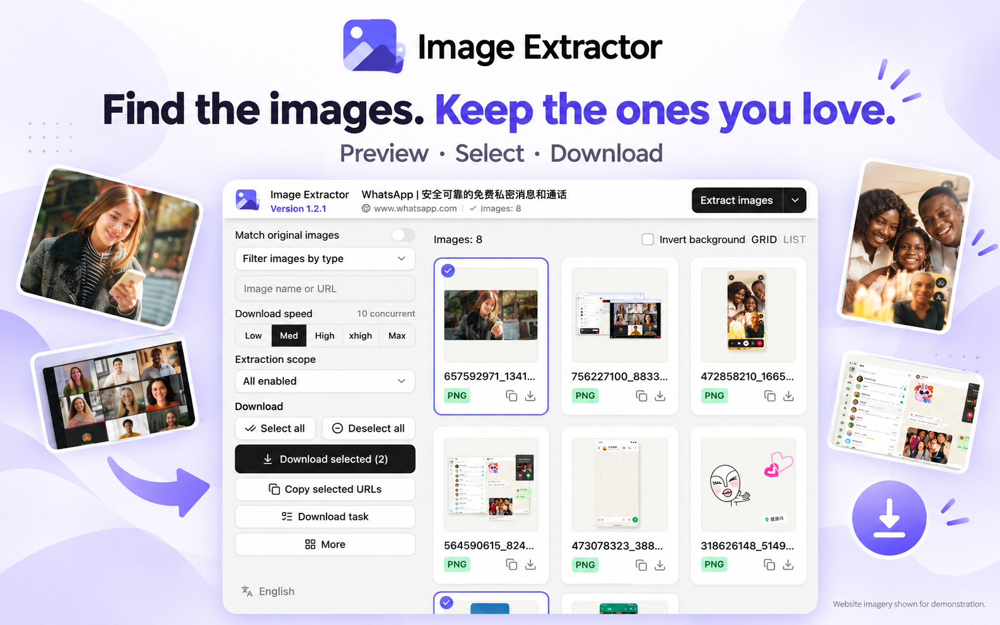
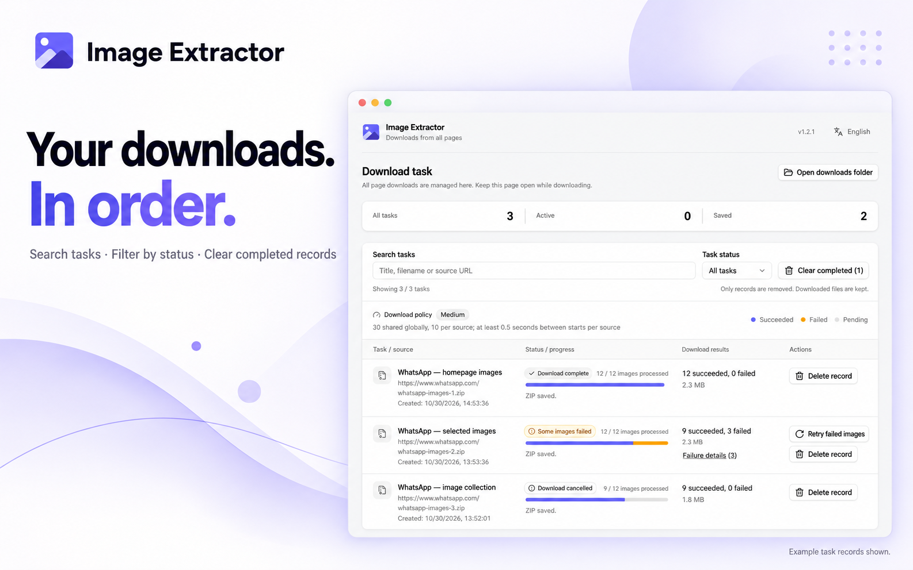
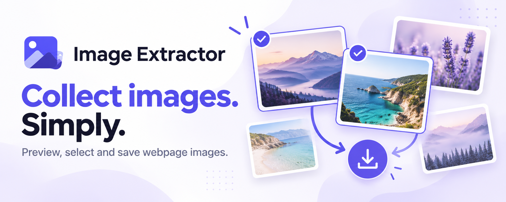

# Chrome Web Store assets

Updated on 2026-10-30 for 1.2.1. The bilingual **1280×800** `screenshot-en.jpg` and `screenshot-zh.jpg` are browser captures of the current popup centered on a neutral canvas. The [screenshot gallery](../screenshots/README.md) records the capture setup, curated WhatsApp image selection and demonstration task records. Existing Store submissions are unchanged.

## Promotional artwork

Three new graphics were created with the built-in image-generation tool from the current interface screenshots. They are promotional illustrations, not unmodified screenshots or download-verification evidence. Generated interface details may differ from the actual product; use the browser captures above for exact UI representation. Original generated dimensions are retained; export to the placement's required dimensions before Store upload.

| Asset | Message |
| --- | --- |
| [Browse and select](promo-browse.png) | Find the images. Keep the ones you love. |
| [Download management](promo-downloads.png) | Your downloads. In order. |
| [Wide brand banner](promo-banner.png) | Collect images. Simply. |

The existing 440×280 promotional tile remains available as `promo-440x280.png`, with its editable `promo-440x280.svg` source. `npm run icons` regenerates that tile, not the new AI artwork.

## Generation direction

- Browse graphic: preserve the popup reference; white and pale lavender, purple brand accents, headline “Find the images. Keep the ones you love.” and “Preview · Select · Download”.
- Task graphic: feature the download-manager reference; headline “Your downloads. In order.” and “Search tasks · Filter by status · Clear completed records”; identify the task records as examples.
- Banner: “Image Extractor”, “Collect images. Simply.” and “Preview, select and save webpage images.”; floating landscape image cards, two purple selection marks and a download arrow; no ratings or unsupported claims.

WhatsApp names and website imagery belong to their respective owners and are not relicensed under MIT. Their use as an example does not imply affiliation or endorsement. The banner's landscape artwork is generated. Store publication remains a separate action.
